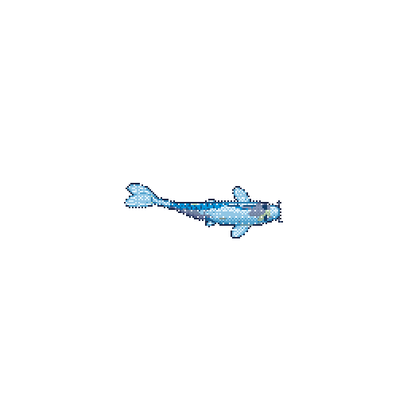

  <h1>Hi, I'm Danesh Muthu Krisnan 👋</h1>
  
<strong>Computer Networks & Security • IoT & Industrial Automation • Cloud & AI</strong>

  

    
    
    
  

---

### 🧑‍💻 About Me
- 🎓 Pursuing a **Bachelor of Computer Science (Computer Networks & Security)** at **Universiti Teknologi Malaysia (UTM)**.
- 🌱 Building **AgriBox**, an industrial IoT smart fertigation and environmental monitoring system powered by the **IRIV PiControl AgriBox** (Raspberry Pi Compute Module).
- 📡 Hands-on experience in **Network Delivery & Automation** (Maxis), cloud infrastructure, and cybersecurity student community initiatives.
- 📍 Based in Malaysia (`Parit, Perak` / `Kuala Lumpur`).

---

### 🛠️ Tech Stack & Focus Areas

| Domain | Tools & Technologies |
| :--- | :--- |
| **Languages** | Python, Rust, C/C++, Bash, JavaScript/TypeScript |
| **Networking & Security** | Network Automation, Linux Systems, Cybersecurity Tooling, Wireshark |
| **Embedded & IoT** | Raspberry Pi Compute Module, Industrial Controllers, Sensors & Telemetry |
| **Cloud & AI** | Google Cloud Platform (GCP), Alibaba Cloud, Docker, GitHub Actions |

---

  

